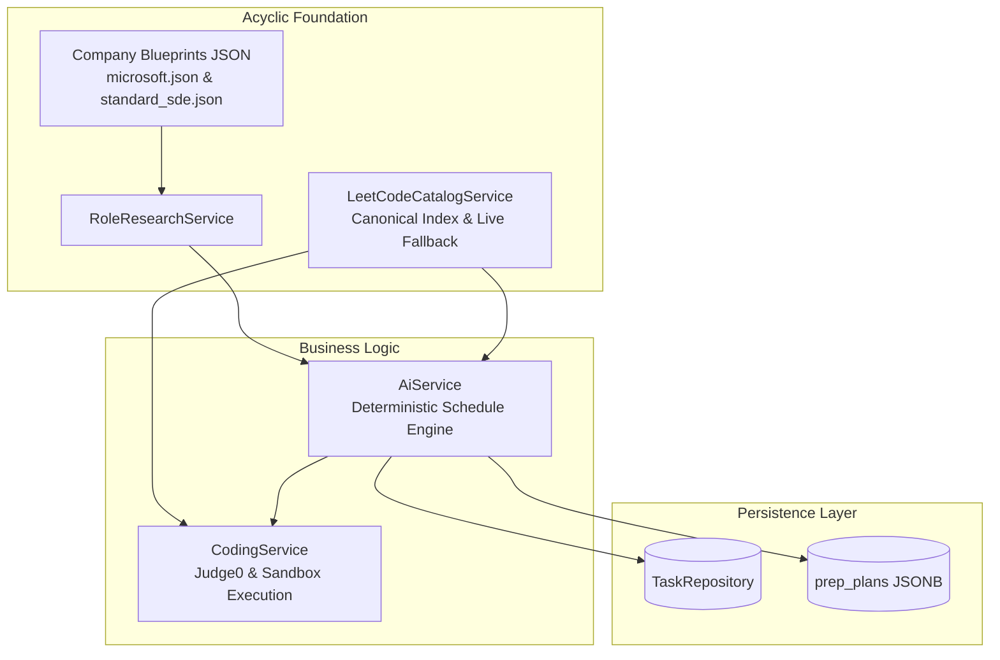

# PlacePrep — Deterministic, Evidence-Grounded Preparation Architect

## Executive Summary
We have implemented a **deterministic, evidence-grounded interview preparation plan engine** in the active Spring Boot backend (`server/`, Spring Boot 3.3.4, Java 21). This replaces open-ended, unreliable LLM roadmap generation with a mathematically bounded, company-verified preparation curriculum engine based on official hiring blueprints, verified LeetCode problem catalogues, daily study time budgets, and candidate diagnostics.

---

## 1. Architectural Design & Zero Circular Dependency

### Eliminating the Circular Dependency
Previously, `CodingService` injected `AiService`. If `AiService` had injected `CodingService` for LeetCode metadata lookup, Spring Boot would fail at startup with a `BeanCurrentlyInCreationException`.

**Solution:**
We introduced `LeetCodeCatalogService` as an independent, acyclic leaf service:
- Both `AiService` and `CodingService` depend on `LeetCodeCatalogService`.
- `LeetCodeCatalogService` has zero dependencies on `AiService` or `CodingService`.
- `CodingService` injects `AiService` and `LeetCodeCatalogService`.
- `AiService` injects `LeetCodeCatalogService` and `RoleResearchService`.
- Result: **Strict, acyclic directed acyclic graph (DAG)** with zero cyclic dependencies.

---

## 2. Blueprint System & 3-Tier Evidence Model

### Immutable Blueprint Record
Defined in [`server/src/main/java/com/placeprep/model/blueprint/CompanyBlueprint.java`](file:///home/zeromv/Downloads/placeprep-main/server/src/main/java/com/placeprep/model/blueprint/CompanyBlueprint.java):
- `CompanyBlueprint`
- `InterviewStage` (stageId, name, studyAllocationPercent, format, rubricTraps, coreTopics, evidenceRefs)
- `BehavioralFramework` (name, principles, sampleQuestions)
- `VerifiedDoc` (title, url, topic, category)
- `SourceEvidence` (title, url, organization, category, supportedClaims, confidence, dateChecked)

### Stage Allocation Integrity
Every blueprint enforces `totalAllocationPercent() == 100`:
- **Microsoft Blueprint (`microsoft.json`)**:
  - Stage 1: *Online Technical Assessment* — 35%
  - Stage 2: *Technical Problem Solving & Data Structures* — 35%
  - Stage 3: *Collaborative Engineering & Growth Mindset* — 30%
  - Total: **100%**
  - Assessment platform: Marked cautiously as `"Variable (Codility / HackerRank / Teams Live Coding depending on org and campus vs experienced track)"` (preventing over-generalization).
  - High-frequency verified LeetCode IDs: `[1, 146, 253, 200, 207, 79, 138, 297, 443, 124, 215, 56, 460, 42]`.
- **Standard SDE Blueprint (`standard_sde.json`)**:
  - Stage 1: *Technical Screening & Online Assessment* — 30%
  - Stage 2: *Core Algorithms & Data Structures* — 40%
  - Stage 3: *System Fundamentals & Behavioral Competency* — 30%
  - Total: **100%**
  - High-frequency verified LeetCode IDs: `[1, 15, 20, 21, 53, 121, 141, 200, 206, 226, 238, 704]`.

---

## 3. Strict Schedule & Daily Budget Invariants

### Schedule Invariants
- Total weeks: $N = \text{durationMonths} \times 4$
  - 1 Month: exactly 4 weeks
  - 2 Months: exactly 8 weeks
  - 3 Months: exactly 12 weeks
- 5 study days per week (`Day 1` through `Day 5`).
- Weekly estimated study hours: Derived directly from the daily time budget:
  $$\text{estimatedHours} = \frac{5 \times \text{timePerDay}}{60.0}$$
  - $120\text{ min/day} \implies 10.0\text{ hours/week}$
  - $90\text{ min/day} \implies 7.5\text{ hours/week}$
  - $60\text{ min/day} \implies 5.0\text{ hours/week}$

### Deliberate Focus Block Scheduling Policy
To eliminate arbitrary time partitions (such as 54 + 42 + 24 minutes or 36 + 24 minutes), the engine applies deliberate **45-, 60-, and 90-minute focus blocks** with structured remainder blocks for synthesis or spaced repetition, while preserving the exact daily-capacity invariant:
- **60 minutes:** 1 block of 60 minutes (`[60]`). DSA deep work block.
- **75 minutes:** 1 block of 60 minutes + 1 block of 15 minutes wrap-up/synthesis (`[60, 15]`).
- **90 minutes:** 2 blocks of 45 minutes (`[45, 45]`). Core coding sprint + CS fundamentals.
- **105 minutes:** 1 block of 60 minutes + 1 block of 45 minutes (`[60, 45]`).
- **120 minutes:** 2 blocks of 60 minutes (`[60, 60]`). DSA problem solving + Architectural / rubric drill.
- **135 minutes:** 1 block of 90 minutes + 1 block of 45 minutes (`[90, 45]`).
- **150 minutes:** 1 block of 90 minutes + 1 block of 60 minutes (`[90, 60]`). Deep problem investigation + Systems review.
- **180 minutes:** 2 blocks of 90 minutes (`[90, 90]`). Double immersive focus blocks.
- **Remainder Policy & Edge Cases:** For arbitrary or non-preset budgets, focus slots are systematically assigned 90-, 60-, or 45-minute intervals to guarantee that any synthesis block is strictly $\le 30$ minutes while ensuring $\sum \text{block\_durations} \equiv \text{timePerDay}$:
  - $\le 45$ min: Single targeted algorithmic sprint of duration $T$ (e.g. 15m $\to [15]$, 30m $\to [30]$, 44m $\to [44]$, 0 synthesis).
  - 46–59 min: 1 block of 45m (DSA) + remainder $\le 14$m (synthesis).
  - 61–89 min: 1 block of 60m (DSA) + remainder $\le 29$m (synthesis) (e.g. 76m $\to [60, 16]$, 89m $\to [60, 29]$).
  - 90–104 min: 2 blocks of 45m (DSA + Core CS) + remainder $\le 14$m (synthesis) (e.g. 91m $\to [45, 45, 1]$, 104m $\to [45, 45, 14]$).
  - 105–119 min: 1 block of 60m + 1 block of 45m + remainder $\le 14$m (synthesis).
  - 120–134 min: 2 blocks of 60m + remainder $\le 14$m (synthesis).
  - 135–149 min: 1 block of 90m + 1 block of 45m + remainder $\le 14$m (synthesis) (e.g. 149m $\to [90, 45, 14]$).
  - 150–179 min: 1 block of 90m + 1 block of 60m + remainder $\le 29$m (synthesis).
  - 180–209 min: 2 blocks of 90m (DSA + Core CS) + remainder $\le 29$m (synthesis).
  - 210–224 min: 1 block of 90m (DSA) + 2 blocks of 60m (Core CS + DSA) + remainder $\le 14$m (synthesis) (e.g. 210m $\to [90, 60, 60]$, 211m $\to [90, 60, 60, 1]$).
  - 225–239 min: 2 blocks of 90m + 1 block of 45m + remainder $\le 14$m (synthesis) (e.g. 239m $\to [90, 90, 45, 14]$).
  - 240–269 min: 2 blocks of 90m + 1 block of 60m + remainder $\le 29$m (synthesis) (e.g. 240m $\to [90, 90, 60]$, 269m $\to [90, 90, 60, 29]$).
  - $\ge 270$ min: Modular 90m blocks with strictly alternating roles + remainder decomposition (e.g. 270m $\to [90, 90, 90]$, 300m $\to [90, 90, 60, 60]$, 600m $\to 6 \times 90\text{m} + 1 \times 60\text{m}$), ensuring synthesis is strictly $\le 30$m.
- **Strict Focus Role Alternation Invariant:** All daily focus blocks strictly alternate between `dsa` and `core_cs` (DSA $\to$ Core CS $\to$ DSA $\to$ Core CS...), maintaining balanced interview preparation across algorithm solving and systems engineering without consecutive duplicate subjects.
- **Input Boundaries & Validation:** Budgets $\le 0$ are rejected with `IllegalArgumentException` at the domain service level (`computeDeliberateBlocks`), preventing zero-length or negative study blocks. Initial request intake sanitizes/defaults non-positive budgets to 120 minutes.

---

## 4. Hallucination Prevention & Canonical Grounding

In `AiService.java`:
1. **Catalog Validation (`normalizeAndValidatePlan`):**
   If an LLM returns a problem title or reference label, `leetCodeCatalogService.findProblem(query)` is queried.
2. **Hallucination Replacement:**
   If the LLM invents an invalid ID or unknown problem (e.g. `LeetCode #99999`), it is automatically replaced with a verified problem from the blueprint's `highFrequencyLeetCodeIds()` (e.g. `146`, `253`, `200`).
3. **Additive Metadata:**
   Every coding task item receives:
   - `leetcodeId`: Integer ID (e.g. `146`)
   - `referenceLabel`: `"LeetCode #146"`
   - `referenceUrl`: Canonical URL (`https://leetcode.com/problems/lru-cache/`)
   - `codingLabUrl`: Deep link (`/coding-lab?problem=146&url=...&title=LRU+Cache`)
   - `rubricInsight`: Concrete interview rubric advice from blueprint stages
   - `whyMattersForRole`: Role-specific justification
   - `evidenceRefs`: Official documentation sources
4. **Resilient Fallback:**
   If AI generation fails, times out, or produces unparseable JSON, `generateDeterministicCurriculum(...)` generates the entire verified curriculum seamlessly with zero user disruption.

---

## 5. Contract Preservation & Task History Integrity

- **Database Contract:** The `prep_plans` JSONB contract (`roadmap`, `tasks`, `resources`, `flashcards`, `time_per_day`, `duration_months`, `target_role`, `metadata`) remains completely intact.
- **Task History Preservation:** In `finalizePlanAfterBaseline`, existing user tasks in `TaskRepository` (especially completed tasks) are **never deleted or overwritten**. Only new pending tasks are added for the current day if the user's pending count is below threshold.
